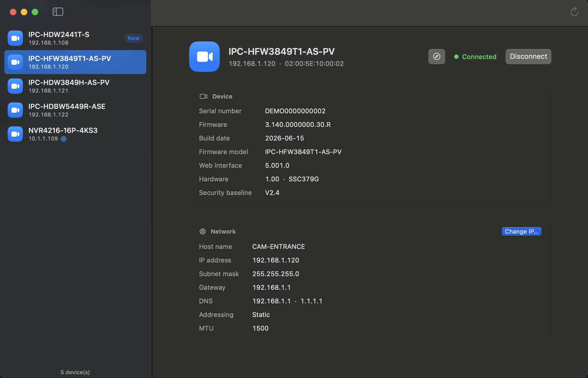

<p align="center"></p>

# CamTool — configuration tool for Dahua cameras

Discover, query and configure the Dahua cameras and recorders on your network from your Apple Silicon Mac.

<p align="center"></p>

> **Independent project, not affiliated with Dahua Technology.**
> "Dahua" is a trademark of its owner, used here only to indicate compatibility.

> **🍎 macOS on Apple Silicon only (M1 or later).**
> CamTool does not build for Intel Macs, Linux or Windows.

## Features

| Status | Feature |
|---|---|
| ✅ | Device discovery on the local network, including devices on other subnets |
| ✅ | Initialization of factory-new devices (admin password) |
| ✅ | Device information and configuration reading |
| ✅ | Network settings changes (IP, mask, gateway, DNS, DHCP) with validation and confirmation |
| ✅ | Devices on another subnet reached through a temporary address on the Mac |
| 🚧 | Batch addressing (consecutive addresses for several devices) — core done, app screen to come |
| 🚧 | Firmware update from a file supplied by the user |

The Mac app covers everything above; the command-line tool covers discovery and reading.

## Requirements

- Mac with Apple Silicon (M1, M2, M3, M4…), macOS 14 Sonoma or later
- To build: Xcode with Swift 6 (the Command Line Tools alone cannot build the SwiftUI app)

The binary is built for arm64 only; the build deliberately fails on any other platform. `make app` signs the app ad hoc, which is enough to run it on the Mac that built it.

## Installation

```sh
make app                    # builds build/CamTool.app
make install-app            # builds it and copies it to /Applications
make release                # builds the command-line tool, .build/release/camtool
sudo make install           # copies the command-line tool to /usr/local/bin
make test                   # runs the tests
```

For screenshots, a debug build can show made-up devices: `swift build && CAMTOOL_DEMO=1 CAMTOOL_LANG=en .build/debug/CamToolApp`.

## Code layout

| Directory | Purpose |
|---|---|
| `Sources/CamToolKit` | Reusable core: discovery, authenticated connection, initialization, network settings |
| `Sources/camtool` | Command-line tool |
| `Sources/CamToolApp` | SwiftUI Mac app |
| `Packaging`, `scripts` | App bundle metadata, bundling script, icon (drawn by `scripts/make-icon.swift`) |
| `docs` | Screenshot (fictitious data from the demo mode) |
| `Tests/CamToolKitTests` | Tests, including a simulated device for the connection |

## Using the app

1. Open CamTool: it searches the network right away (⌘R to search again).
2. Select a device. A **New** badge marks a factory-new device: click **Initialize…** and choose its admin password.
3. Click **Connect**, then **Change IP…** on the Network card.

CamTool always checks that the device answering is the one selected (by its MAC address) before writing anything, which matters when several new devices share the factory address 192.168.1.108. Each login is attempted once only.

### Devices on another subnet

A device at 10.1.1.109 cannot be reached from a Mac on 192.168.1.0/24. CamTool then adds a **temporary address** in the device's subnet to the Mac's network interface; macOS asks for your administrator password for that. The address is removed as soon as it is no longer needed (for instance after moving the device into the Mac's subnet), when you click **Remove**, when you quit CamTool, or at the next launch if CamTool was closed abruptly.

## Command-line tool

Messages are in English, or in French when French is your Mac's preferred language. Set `CAMTOOL_LANG=en` or `CAMTOOL_LANG=fr` to force one.

```sh
camtool discover                   # listens for 3 s and lists the devices
camtool discover -t 10 --json      # 10 s, JSON output
camtool discover -i 192.168.1.20   # force the network interface (Mac with several adapters)
```

Discovery sends a `DHDiscover.search` request over multicast (`239.255.255.251`, UDP 37810) and broadcast, then reads the replies that devices publish on their own. If nothing answers, check that the macOS firewall allows camtool to accept incoming connections.

### Connecting to a device (credentials required)

```sh
camtool info 192.168.1.108 -u admin                 # model, serial number, firmware
camtool config 192.168.1.108 Network                # read a configuration section
camtool call 192.168.1.108 magicBox.getDeviceType   # raw RPC call
```

The connection uses the device's JSON-RPC HTTP API (`/RPC2_Login`, `/RPC2`, port 80). The DHIP transport over TCP 37777 is still available with `--dhip`, as an experimental option: the tested firmwares (2.800 to 3.140) do not answer on it.

The password is typed at the keyboard (or read from `CAMTOOL_PASSWORD`), never passed as an argument. Authentication uses challenge-response: the password is never sent in clear text. CamTool makes **a single attempt** per command. Several failed attempts in a row may lock the account on the device.

## Authorized use

- CamTool is meant for **your own network** or a network you are **authorized** to work on. Intercepting traffic on a network you do not administer is a criminal offense.
- CamTool **requires valid credentials** for anything beyond discovery. It contains no exploit, no authentication bypass and no brute-force tool.
- The protocol was reimplemented independently, by observing the network traffic of tools used legitimately and the web interface served by the devices themselves (interoperability, Article 5(3) of EU Directive 2009/24/EC, transposed in France as Article L122-6-1 of the Intellectual Property Code). This repository contains **no Dahua code, SDK, DLL or firmware**.

## ⚠️ Warning — firmware updates

An interrupted or unsuitable firmware update can leave a device **permanently unusable**. Only use firmware downloaded from the manufacturer's official website for the exact model concerned. You do so at your own risk.

## License

[MIT](LICENSE) — software provided "as is", **without any warranty**.
